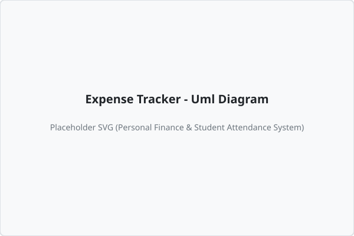
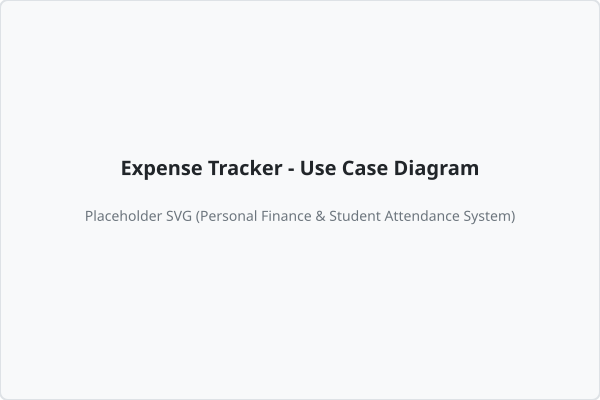
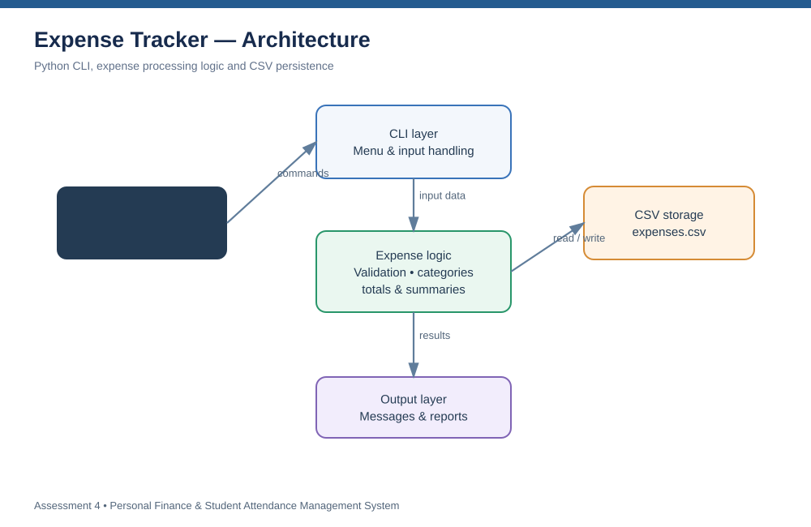
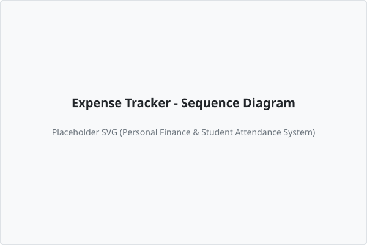
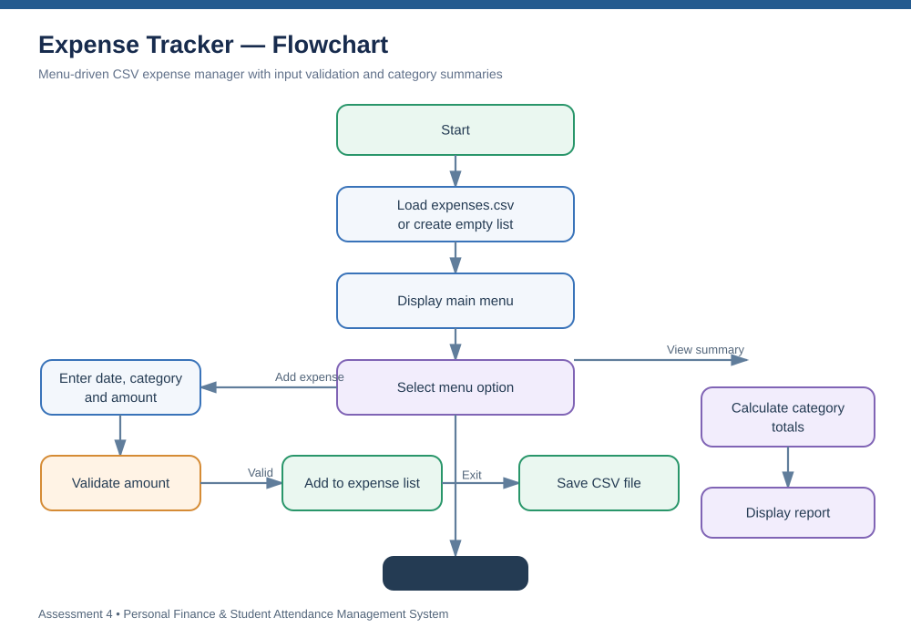
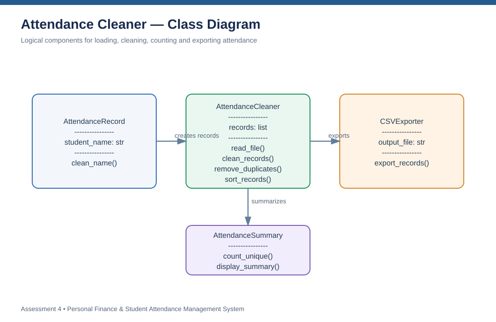
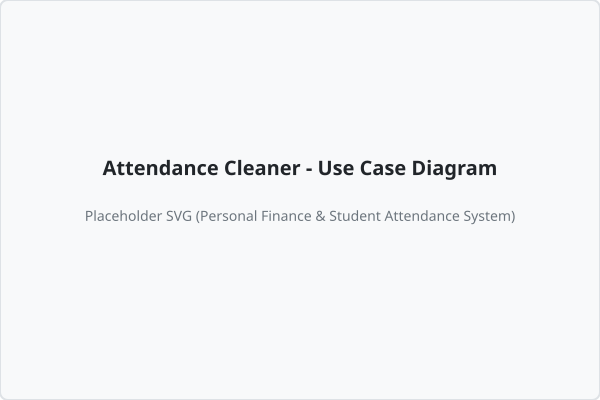
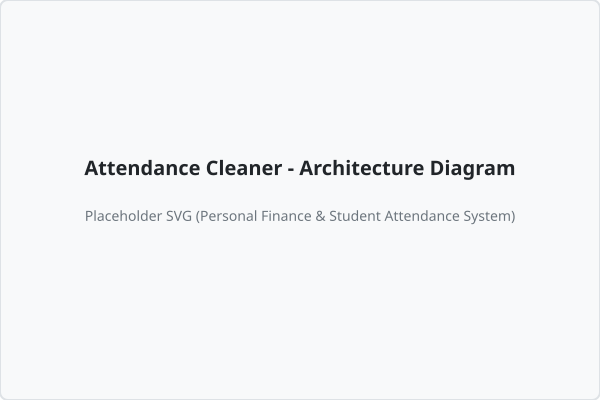
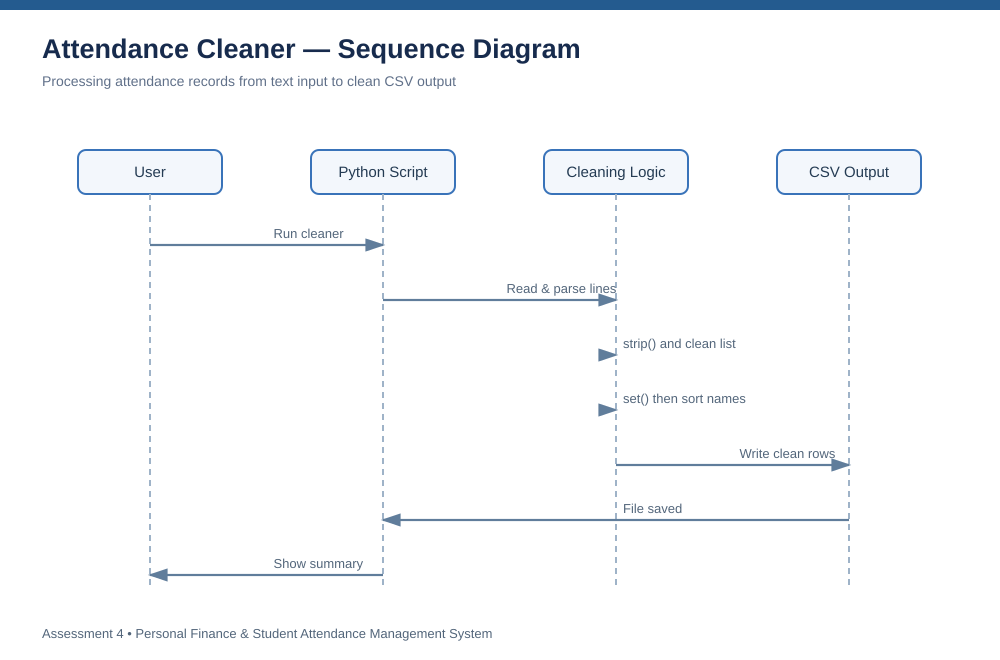
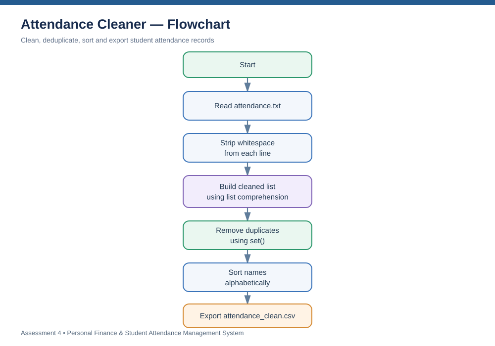

 <!-- ================= ANIMATED HEADER ================= -->

<div align="center">


<br>


<br>

**A practical Python project demonstrating file handling, exception handling, data cleaning, CSV operations, lists, sets, and data processing.**

<br>

<a href="https://aliabbas0014.github.io/python-files-errors-assessment/demo.html">
  
</a>

</div>

---

## 📌 Table of Contents

- [Project Overview](#-project-overview)
- [Project Modules](#-project-modules)
- [Key Features](#-key-features)
- [Live Demo](#-live-demo)
- [Project Structure](#-project-structure)
- [System Design Diagrams](#-system-design-diagrams)
  - [Expense Tracker Diagrams](#1-institute-expense-tracker-diagrams)
  - [Attendance Cleaner Diagrams](#2-student-attendance-cleaner-diagrams)
- [Technologies Used](#-technologies-used)
- [Python Concepts Implemented](#-python-concepts-implemented)
- [Installation and Setup](#-installation-and-setup)
- [How to Run](#-how-to-run-the-applications)
- [Application Workflows](#-application-workflows)
- [Test Cases](#-test-cases)
- [Use Cases](#-use-cases)
- [Sample Outputs](#-sample-outputs)
- [Error Handling](#-error-handling)
- [Generated Files](#-generated-files)
- [Learning Outcomes](#-learning-outcomes)
- [Limitations and Future Improvements](#-limitations-and-future-improvements)
- [Author](#-author)

---

## 📖 Project Overview

**Python Management Suite** is a command-line based project developed as part of **Assessment 04: Personal Finance & Student Attendance Management System**.

The project consists of two independent Python applications designed to demonstrate practical programming concepts through simple, real-world management tasks.

The first application manages institute expenses by recording expense details, storing them in a CSV file, displaying saved records, and calculating category-wise totals.

The second application processes student attendance records by cleaning names, removing duplicate entries, sorting students alphabetically, and exporting the final attendance list to a CSV file.

Both applications use Python's built-in libraries and fundamental programming techniques.

### 🎯 Project Objectives

- Understand Python file handling.
- Work with CSV and text files.
- Handle common runtime errors using exceptions.
- Validate user input.
- Remove duplicate records using sets.
- Apply list comprehension for data cleaning.
- Process and organize data using loops.
- Store and retrieve information using files.

---

## 🧩 Project Modules

### 1. Institute Expense Tracker

**File:** `expense_tracker.py`

A simple expense management application that allows users to record and analyze institute expenses.

**Main Features:**

- Add new expense records.
- Enter expense date, item, category, and amount.
- Validate dates using Python's `datetime` module.
- Validate numeric expense amounts.
- Save expense records in `expenses.csv`.
- Load previously saved records when the program starts.
- Display all recorded expenses.
- Identify unique expense categories using a set.
- Calculate total expenses for each category.
- Handle missing CSV files using `FileNotFoundError`.

**Available Menu:**

| Option | Function |
|---|---|
| 1 | Add New Expense |
| 2 | Show All Expenses |
| 3 | Calculate Total Expenses by Category |
| 4 | Exit |

### 2. Student Attendance Cleaner

**File:** `attendance_cleaner.py`

A data-cleaning application that processes student attendance records stored in a text file.

**Main Features:**

- Read student names from `attendance.txt`.
- Remove unnecessary spaces using `strip()`.
- Standardize student names using `title()`.
- Clean records using list comprehension.
- Remove duplicate names using a set.
- Count original and unique student records.
- Sort student names alphabetically.
- Export cleaned records to `attendance_clean.csv`.

---

## ✨ Key Features

| Feature | Description |
|---|---|
| File Handling | Read and write external files |
| CSV Management | Store structured expense and attendance data |
| Exception Handling | Handle missing files and invalid input |
| Input Validation | Validate expense dates and amounts |
| Duplicate Removal | Remove repeated student names |
| Data Cleaning | Standardize names and remove extra spaces |
| Category Analysis | Calculate category-wise expense totals |
| Alphabetical Sorting | Organize student records |
| Data Persistence | Preserve expense records between program runs |

---

## 🌐 Live Demo

Explore the interactive browser-based project showcase:

<div align="center">

<a href="https://aliabbas0014.github.io/python-files-errors-assessment/demo.html">
  
</a>

</div>

The demo provides a visual preview of both project modules, including sample expense management and attendance-cleaning interactions.

**Note:** The browser demo is a JavaScript-based simulation for demonstration purposes. The actual applications are written in Python and must be executed separately using a Python environment.

---

## 📁 Project Structure

```text
python-files-errors-assessment/
│
├── expense_tracker.py
│   └── Institute Expense Tracker application
│
├── attendance_cleaner.py
│   └── Student Attendance Cleaner application
│
├── attendance.txt
│   └── Original student attendance records
│
├── demo.html
│   └── Interactive project showcase
│
├── README.md
│   └── Project documentation
│
├── assets/
│   │
│   ├── expense-tracker/
│   │   ├── uml-diagram.svg
│   │   ├── use-case-diagram.svg
│   │   ├── architecture-diagram.svg
│   │   ├── sequence-diagram.svg
│   │   └── flowchart.svg
│   │
│   └── attendance-cleaner/
│       ├── uml-diagram.svg
│       ├── use-case-diagram.svg
│       ├── architecture-diagram.svg
│       ├── sequence-diagram.svg
│       └── flowchart.svg
│
├── expenses.csv
│   └── Generated expense records
│
└── attendance_clean.csv
    └── Generated cleaned attendance records
```

**Note:** `expenses.csv` and `attendance_clean.csv` are generated output files. They are created when the respective applications run; they do not need to exist before the first execution.

---

## 🏗️ System Design Diagrams

This section presents the visual system designs of both applications. Each application has its own UML, Use Case, Architecture, Sequence, and Flowchart diagrams to explain its internal structure and execution process.

### 1. Institute Expense Tracker Diagrams

These diagrams represent the structure, functionality, architecture, and execution flow of the Institute Expense Tracker.

#### 1.1 UML Class Diagram



#### 1.2 Use Case Diagram



#### 1.3 System Architecture Diagram



#### 1.4 Sequence Diagram



#### 1.5 Program Flowchart



---

### 2. Student Attendance Cleaner Diagrams

These diagrams represent the structure, functionality, architecture, and data-processing workflow of the Student Attendance Cleaner.

#### 2.1 UML Class Diagram



#### 2.2 Use Case Diagram



#### 2.3 System Architecture Diagram



#### 2.4 Sequence Diagram



#### 2.5 Program Flowchart



---

## 🛠 Technologies Used

| Technology | Purpose |
|---|---|
| Python 3 | Main programming language |
| CSV Module | Reading and writing CSV files |
| datetime Module | Expense date validation |
| HTML5 | Demo page structure |
| CSS3 | Demo styling and animations |
| JavaScript | Interactive browser demonstration |
| Git & GitHub | Version control and project hosting |
| GitHub Pages | Hosting the interactive demo |

All Python functionality uses built-in Python modules. No external Python packages are required.

---

## 🧠 Python Concepts Implemented

| Concept | Application |
|---|---|
| Variables | Store expense and student information |
| Lists | Maintain expense records and cleaned names |
| Dictionaries | Represent individual expense records |
| Sets | Identify unique categories and students |
| Loops | Process records and display information |
| Conditional Statements | Control menu options and validation |
| List Comprehension | Clean student attendance records |
| Functions | Use functions for processing and calculations |
| File Handling | Read and write text and CSV files |
| Exception Handling | Manage missing files and invalid input |
| CSV Reader | Read existing expense records |
| CSV Writer | Save expense and attendance data |
| `strip()` | Remove unnecessary spaces |
| `title()` | Standardize student name formatting |
| `sorted()` | Arrange student names alphabetically |
| `datetime.strptime()` | Validate date format |

---

## ⚙️ Installation and Setup

### Prerequisites

Make sure the following tools are installed:

- Python 3.x
- Visual Studio Code (recommended)
- Git (optional, for cloning the repository)

### Step 1: Clone the Repository

Open your terminal and run:

```bash
git clone https://github.com/aliabbas0014/python-files-errors-assessment.git
```

### Step 2: Open the Project Folder

```bash
cd python-files-errors-assessment
```

### Step 3: Verify Python Installation

```bash
py --version
```

If the Python launcher is unavailable, try:

```bash
python --version
```

No additional packages or dependencies need to be installed.

---

## ▶️ How to Run the Applications

### Run Application 1: Expense Tracker

```bash
py expense_tracker.py
```

Follow the displayed menu and select the required option.

### Run Application 2: Attendance Cleaner

First, make sure `attendance.txt` is available in the project directory.

Then execute:

```bash
py attendance_cleaner.py
```

The program will process the attendance records and generate `attendance_clean.csv`.

---

## 🔄 Application Workflows

### Expense Tracker Workflow

```text
Start Application
       |
       v
Load Existing Expenses
       |
       v
Display Main Menu
       |
       v
User Selects an Option
       |
       +-------------------------+
       |            |            |
       v            v            v
   Add Expense  Show Records  Category Total
       |            |            |
       v            v            v
 Validate Input  Display Data  Calculate Sum
       |
       v
   Save to CSV
       |
       v
 Return to Main Menu
       |
       v
      Exit
```

### Attendance Cleaner Workflow

```text
Start Application
       |
       v
Read attendance.txt
       |
       v
Clean Student Names
       |
       v
Remove Extra Spaces
       |
       v
Standardize Name Format
       |
       v
Identify Unique Students
       |
       v
Sort Alphabetically
       |
       v
Save to attendance_clean.csv
       |
       v
Display Attendance Report
```

---

## 🧪 Test Cases

The following test cases describe expected application behavior for normal inputs, duplicate records, and common errors.

### Application 1: Expense Tracker

| Test ID | Test Scenario | Expected Result |
|---|---|---|
| ET-01 | Start without an existing CSV file | Start with an empty expense list |
| ET-02 | Add a valid expense | Save the expense successfully |
| ET-03 | Enter an invalid amount | Display an error and request the amount again |
| ET-04 | Enter an invalid date | Display an error and request the date again |
| ET-05 | Display expenses when records exist | Show all saved expenses |
| ET-06 | Calculate category totals | Display correct category-wise totals |
| ET-07 | Select an invalid menu option | Display an invalid choice message |
| ET-08 | Exit the application | Display exit message and terminate |

### Application 2: Attendance Cleaner

| Test ID | Test Scenario | Expected Result |
|---|---|---|
| AC-01 | Read a valid attendance file | Successfully load student names |
| AC-02 | Names contain extra spaces | Remove unnecessary spaces |
| AC-03 | Names contain different letter cases | Standardize names |
| AC-04 | Duplicate names exist | Keep only unique names |
| AC-05 | Names are not alphabetically sorted | Sort them alphabetically |
| AC-06 | Attendance file is missing | Display an error message |
| AC-07 | Attendance file is empty | Generate an empty cleaned list |
| AC-08 | Save cleaned records | Generate `attendance_clean.csv` |

### Sample Test Data

**Input: `attendance.txt`**

```text
ali
Ahmed
 sara
ALI
ahmed
usman
Sara
 usman
```

**Expected Results:**

| Test Metric | Expected Value |
|---|---:|
| Original Records | 8 |
| Unique Students | 4 |
| Duplicate Records | 4 |

Cleaned list:

```text
Ahmed
Ali
Sara
Usman
```

---

## 💼 Use Cases

### Expense Tracker

| Use Case | Description |
|---|---|
| Record Expenses | An institute employee enters a new expense |
| Review Expenses | A user views previously recorded expenses |
| Analyze Spending | A user checks total expenses by category |
| Preserve Records | Expense information remains available after restarting the program |

### Attendance Cleaner

| Use Case | Description |
|---|---|
| Attendance Processing | An institute processes student attendance records |
| Data Cleaning | Remove unnecessary spaces and inconsistent capitalization |
| Duplicate Detection | Identify repeated student entries |
| Record Organization | Arrange student names alphabetically |
| Data Export | Generate a cleaned attendance CSV file |

---

## 📊 Sample Outputs

### Expense Tracker

Example expense record:

```text
Date: 13-11-2026
Item: Stationery
Category: Supplies
Amount: 2500
```

Example category summary:

```text
----- EXPENSES BY CATEGORY -----

Supplies : 2500.0
Utilities : 5000.0
Transport : 1500.0
```

### Attendance Cleaner

Example output:

```text
===== STUDENT ATTENDANCE REPORT =====

Original Records: 8
Unique Students: 4

----- CLEANED ATTENDANCE LIST -----

Ahmed
Ali
Sara
Usman

Cleaned attendance saved successfully!
```

*Sample outputs are illustrative examples of the expected application behavior.*

---

## 🛡 Error Handling

The applications include basic error-handling mechanisms to improve reliability.

### 1. FileNotFoundError

Used when the required file does not exist.

- Expense Tracker starts with an empty list if `expenses.csv` is missing.
- Attendance Cleaner displays a message if `attendance.txt` is missing.

### 2. ValueError

Used to handle invalid user input.

- Invalid expense amounts are rejected.
- Invalid expense dates are rejected.

### 3. Input Validation

The Expense Tracker validates the date format and numeric amount before saving a new record.

### 4. Empty Records

The applications check whether records are available before displaying or processing them.

---

## 📂 Generated Files

### expenses.csv

Stores expense records in CSV format.

Example:

```csv
date,item,category,amount
13-11-2026,Stationery,Supplies,2500
13-11-2026,Electricity,Utilities,5000
```

### attendance_clean.csv

Stores cleaned student attendance records.

Example:

```csv
Student Name
Ahmed
Ali
Sara
Usman
```

These files allow the applications to store and organize data in a structured format.

---

## 🎓 Learning Outcomes

Through this assessment, the following programming skills were practiced:

- Working with external files in Python.
- Reading and writing CSV data.
- Understanding exception handling.
- Applying input validation.
- Using lists, dictionaries, and sets.
- Implementing list comprehension.
- Removing duplicate data.
- Sorting and organizing records.
- Building practical command-line applications.
- Understanding basic data-processing workflows.

---

## 🚀 Limitations and Future Improvements

The project focuses on fundamental Python programming concepts. It can be extended with additional functionality in the future.

Possible improvements include:

- Add expense editing and deletion.
- Generate monthly and yearly expense reports.
- Add expense search and filtering.
- Validate and standardize expense categories.
- Export additional attendance reports.
- Add student IDs and attendance dates.
- Create a graphical user interface.
- Connect applications to a database.
- Add automated unit tests.

---

## 👨‍💻 Author

<div align="center">


<br><br>

**Ali Abbas**

Software Engineering Graduate | Python Learner

[](https://github.com/aliabbas0014)

[](https://aliabbas0014.github.io/Portfolio)

<br>

If you find this project useful, consider giving it a ⭐ on GitHub!

</div>

---

<div align="center">


**Built with Python. Focused on Learning. Inspired by Real-World Problems.**

</div>
